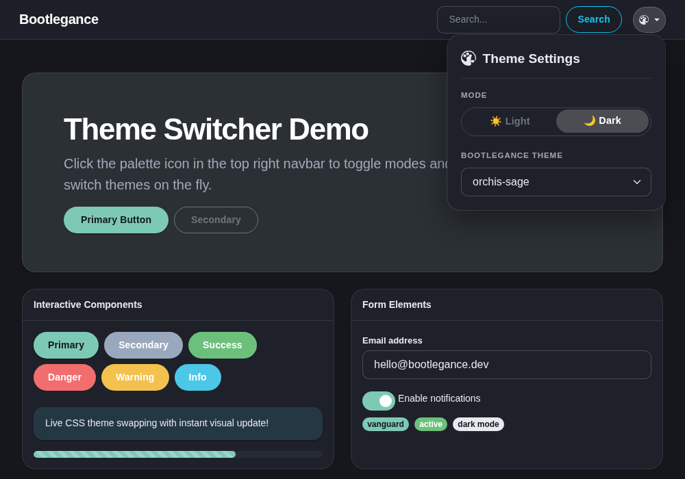

# Bootlegance

Elegant Bootstrap themes that redefine your project's aesthetic.

Bootlegance is a collection of carefully crafted Bootstrap 5 themes designed to elevate the look and feel of your projects. From bold brutalist designs to refined minimalism, each theme is built to make your applications stand out.

## Live Gallery

[**View Theme Gallery**](https://bootlegance.lesichkov.co.uk/)

## Features

- **Native Dark Mode Support** — Built on Bootstrap 5.3+ with automatic light/dark mode switching via `data-bs-theme`
- **Production-Ready** — Thoroughly tested and optimized for real-world use
- **Easy Integration** — Simply swap in a CSS file; no configuration needed
- **Modern Design** — Contemporary aesthetics grounded in design principles
- **Responsive** — Fully responsive across all device sizes
- **Accessible** — WCAG compliant with semantic HTML

## Getting Started

### Installation

1. Download a theme CSS file from the [Bootlegance releases](https://github.com/lesichkovm/bootlegance/releases)
2. Add it to your project after Bootstrap's default CSS:

```html
<link href="https://cdn.jsdelivr.net/npm/bootstrap@5.3.0/dist/css/bootstrap.min.css" rel="stylesheet">
<!-- Load latest theme CSS from CDN -->
<link href="https://cdn.jsdelivr.net/gh/lesichkovm/bootlegance@latest/themes/{theme-name}/theme.css" rel="stylesheet">

<!-- Load specific version of theme CSS from CDN -->
<link href="https://cdn.jsdelivr.net/gh/lesichkovm/bootlegance@{release-tag}/themes/{theme-name}/theme.css" rel="stylesheet">
```

3. That's it! Your Bootstrap components now have the Bootlegance theme applied.

### Dark Mode

Toggle dark mode by adding `data-bs-theme="dark"` to your `<html>` element:

```html
<html data-bs-theme="dark">
  <!-- Your content -->
</html>
```

Or dynamically switch with JavaScript:

```javascript
document.documentElement.setAttribute('data-bs-theme', 'dark');
```

## Reusable Theme Switcher (`bootlegance.js`)

Bootlegance includes a dependency-free vanilla JavaScript script (`bootlegance.js`) that manages theme loading, cookie persistence, query parameter overrides, light/dark mode toggling, accessible font size scaling (increase / decrease / reset), and optional automatic UI wiring.



Try out the [**Live Theme Switcher Demo**](https://bootlegance.lesichkov.co.uk/demo.html).

### Quick Start (Client-Side Switching)

Include the script in your page. It automatically resolves the theme, injects `<link id="bootlegance-theme" rel="stylesheet">`, and loads the theme stylesheet:

```html
<!-- Load Bootstrap -->
<link href="https://cdn.jsdelivr.net/npm/bootstrap@5.3.3/dist/css/bootstrap.min.css" rel="stylesheet">

<!-- Load Bootlegance theme switcher -->
<script src="https://cdn.jsdelivr.net/gh/lesichkovm/bootlegance@latest/bootlegance.js"></script>
```

### Auto-UI Controls

You can automatically render a theme picker `<select>` dropdown and wire light/dark mode toggle buttons using `data-*` attributes:

```html
<!-- Theme picker dropdown container -->
<div data-bootlegance-picker></div>

<!-- Mode toggles -->
<button data-bootlegance-mode="light" class="btn btn-outline-secondary">Light</button>
<button data-bootlegance-mode="dark" class="btn btn-outline-secondary">Dark</button>

<!-- Font size controls (Accessibility) -->
<button data-bootlegance-font-size="down" class="btn btn-outline-secondary">A−</button>
<span data-bootlegance-font-size-value>100%</span>
<button data-bootlegance-font-size="up" class="btn btn-outline-secondary">A+</button>
<button data-bootlegance-font-size="reset" class="btn btn-outline-secondary">Reset</button>

<script src="https://cdn.jsdelivr.net/gh/lesichkovm/bootlegance@latest/bootlegance.js"
        data-default-theme="vanguard"></script>
```

### Configuration Attributes

The script tag accepts optional attributes:

| Attribute | Description | Default |
|---|---|---|
| `data-default-theme` | Fallback theme if no cookie or query param is found | `vanguard` |
| `data-endpoint` | Server endpoint URL (e.g. `/theme`) for server-side redirection mode | `null` (client-side swap) |
| `data-base-url` | Override base CDN or asset URL for themes and `themes.json` | Auto-detected from script `src` |
| `data-themes` | Comma-separated list of fallback theme slugs | (Fetched from `themes.json`) |
| `data-mode-storage-key` | `localStorage` key for light/dark mode persistence | `cf-theme` |
| `data-mode-attribute` | Attribute on `<html>` for light/dark mode | `data-bs-theme` |
| `data-font-size-storage-key` | `localStorage` key for font size persistence | `cf-font-size` |

### Theme Resolution Priority

1. `?theme=` URL query parameter (e.g. `https://example.com/?theme=dracula`)
2. `theme` cookie
3. `data-default-theme` attribute on the script tag
4. Built-in default theme (`vanguard`)

Theme names are validated against `^[a-z0-9-]+$`.

### JavaScript API

The script exposes a global `window.Bootlegance` object:

```javascript
// Get list of registered themes
console.log(Bootlegance.themes);

// Get current theme slug
console.log(Bootlegance.current());

// Switch to a new theme
Bootlegance.set('dracula');

// Get stylesheet URL for a theme
console.log(Bootlegance.url('dracula'));

// Set mode ('light', 'dark', or 'auto')
Bootlegance.setMode('dark');

// Get current mode ('light' or 'dark')
console.log(Bootlegance.getMode());

// Listen for theme changes
window.addEventListener('bootlegance:change', (e) => {
  console.log('Active theme changed to:', e.detail.theme);
});

// Font size accessibility controls
console.log(Bootlegance.getFontSize()); // e.g. 100 (%)
Bootlegance.increaseFontSize();        // Increases scale by 10% (clamped at 200%)
Bootlegance.decreaseFontSize();        // Decreases scale by 10% (clamped at 70%)
Bootlegance.setFontSize(125);          // Explicitly set scale (70% - 200%)
Bootlegance.resetFontSize();           // Resets scale to 100%

// Listen for font size changes
window.addEventListener('bootlegance:fontsize', (e) => {
  console.log('Font size scale changed to:', e.detail.fontSize);
});
```

### Server-Side Contract (FOUC Prevention & Optional Endpoint)

To avoid Flash of Unstyled Content (FOUC) on server-rendered websites, backends can integrate with Bootlegance's cookie contract:

1. **Server-rendered stylesheet**: Read the `theme` cookie on each incoming request and emit the `<link>` directly in the HTML `<head>`:
   ```html
   <link id="bootlegance-theme" rel="stylesheet" href="https://cdn.jsdelivr.net/gh/lesichkovm/bootlegance@latest/themes/{{ theme }}/theme.css">
   ```
2. **Server-endpoint mode**: Set `data-endpoint="/theme"` on the `<script>` tag. When `Bootlegance.set('theme-name')` is called (or a user selects a theme from the auto-UI picker), it redirects to `{endpoint}?theme={name}&redirect={currentPath+Query}`.

#### Reference Implementation (Go HTTP Handler)

Here is a minimal reference Go handler implementing the server contract:

```go
package main

import (
	"net/http"
	"net/url"
	"regexp"
	"strings"
	"time"
)

var validThemeSlug = regexp.MustCompile(`^[a-z0-9-]+$`)

func themeHandler(w http.ResponseWriter, r *http.Request) {
	theme := r.URL.Query().Get("theme")
	redirect := r.URL.Query().Get("redirect")

	// Validate theme name
	if !validThemeSlug.MatchString(theme) {
		theme = "vanguard"
	}

	// Set cookie: Path=/, 1 year expiration, Lax SameSite
	http.SetCookie(w, &http.Cookie{
		Name:     "theme",
		Value:    theme,
		Path:     "/",
		Expires:  time.Now().Add(365 * 24 * time.Hour),
		MaxAge:   365 * 24 * 60 * 60,
		SameSite: http.SameSiteLaxMode,
		Secure:   r.TLS != nil || r.Header.Get("X-Forwarded-Proto") == "https",
		HttpOnly: false, // Accessible to Bootlegance JS
	})

	// Prevent open redirects: allow only local paths starting with '/' and not '//'
	if redirect == "" || !strings.HasPrefix(redirect, "/") || strings.HasPrefix(redirect, "//") {
		redirect = "/"
	}

	http.Redirect(w, r, redirect, http.StatusFound)
}
```

### Generating `themes.json`

Before publishing or releasing a new version, run the manifest generator to update `themes.json`:

```bash
./scripts/generate-themes-json
```

This updates `themes.json` at the repo root with all available theme directories containing a `theme.css`.

## Available Themes

> Every theme ships exactly **two modes** — light and dark. A different palette is a
> separate theme (e.g. Dracula and Dracula Soft), not an extra mode.

| Theme | Description | Preview | Best For |
|---|---|---|---|
| **Adwaita** | Neutral GNOME/libadwaita foundation, adaptive | [Preview](https://bootlegance.lesichkov.co.uk/themes/adwaita/) | Enterprise/desktop apps, accessibility-first, Linux |
| **Ant Design** | Enterprise-grade UI design language | [Preview](https://bootlegance.lesichkov.co.uk/themes/ant-design/) | Enterprise dashboards, complex data-heavy applications |
| **Ayu** | A simple, bright, and elegant theme designed for all day coding comfort. | [Preview](https://bootlegance.lesichkov.co.uk/themes/ayu/) | Developers, code-heavy UIs, editors |
| **Brutalski** | Bold, raw, geometric brutalism | [Preview](https://bootlegance.lesichkov.co.uk/themes/brutalski/) | Developers, tech-forward projects, design portfolios |
| **Carbon** | Clinical, precise, enterprise-ready | [Preview](https://bootlegance.lesichkov.co.uk/themes/carbon/) | Enterprise apps, dashboards, developer tools |
| **Catppuccin** | Official Catppuccin palette, 4 flavours | [Preview](https://bootlegance.lesichkov.co.uk/themes/catppuccin/) | Developer tools, terminals, editors, cozy apps |
| **Catppuccin Frappé** | The softer mid-dark Catppuccin flavour, with light accents re-mixed for a bright surface. | [Preview](https://bootlegance.lesichkov.co.uk/themes/catppuccin-frappe/) | Sibling of **Catppuccin** |
| **Catppuccin Macchiato** | The mid-dark Catppuccin flavour, with light accents re-mixed for a bright surface. | [Preview](https://bootlegance.lesichkov.co.uk/themes/catppuccin-macchiato/) | Sibling of **Catppuccin** |
| **Cerulean** | Port of Bootswatch Cerulean — A calm blue sky with subtle text shadows and glossy gradients. | [Preview](https://bootlegance.lesichkov.co.uk/themes/cerulean/) | Web applications, calm modern portals, corporate UIs |
| **Civic** | Inspired by the U.S. Web Design System (USWDS) | [Preview](https://bootlegance.lesichkov.co.uk/themes/civic/) | Government, digital services, accessibility-first |
| **Classic Mac OS** | System 7 / Mac OS 8 Platinum desktop interface | [Preview](https://bootlegance.lesichkov.co.uk/themes/mac-classic/) | Retro projects, nostalgic UIs |
| **Cosmo** | Port of Bootswatch Cosmo — An ode to Metro. Clean, flat, and modern. | [Preview](https://bootlegance.lesichkov.co.uk/themes/cosmo/) | Modern web applications, dashboards, Metro-inspired UIs |
| **Cyborg** | Port of Bootswatch Cyborg — Jet black and electric blue dark futuristic aesthetic. | [Preview](https://bootlegance.lesichkov.co.uk/themes/cyborg/) | Dark dashboards, tech applications, futuristic UIs |
| **Cyberpunk / Synthwave '84** | Neon option for gaming and entertainment with glowing cyan/magenta accents. | [Preview](https://bootlegance.lesichkov.co.uk/themes/cyberpunk/) | Gaming, entertainment, synthwave UIs |
| **Darkly** |  | [Preview](https://bootlegance.lesichkov.co.uk/themes/darkly/) | Flatly in night mode |
| **Dracula** | Vibrant neon palette with an optional glow layer | [Preview](https://bootlegance.lesichkov.co.uk/themes/dracula/) | Editor-adjacent apps, terminals, striking dashboards |
| **Dracula Soft** | The same eleven colours, softened | [Preview](https://bootlegance.lesichkov.co.uk/themes/dracula-soft/) | Long sessions, calmer workspaces, shared screens |
| **Editorial / Paper** | Serif typography and warm off-white parchment paper for blogs and docs. | [Preview](https://bootlegance.lesichkov.co.uk/themes/editorial/) | Blogs, documentation, publishing |
| **Everforest** | A green, comfortable, low-contrast palette designed to be easy on the eyes. | [Preview](https://bootlegance.lesichkov.co.uk/themes/everforest/) | Developers, code-heavy UIs, editors |
| **Flatly** | Port of Bootswatch Flatly — Flat and modern design with clean emerald accents. | [Preview](https://bootlegance.lesichkov.co.uk/themes/flatly/) | Modern web applications, flat UI, dashboards |
| **Fluent** | Windows 11 Fluent Design theme | [Preview](https://bootlegance.lesichkov.co.uk/themes/fluent/) | Modern desktop apps, Windows-centric UIs, web applications |
| **Forest** | Natural, earthy, organic | [Preview](https://bootlegance.lesichkov.co.uk/themes/forest/) | Eco-conscious brands, wellness, sustainability |
| **GitHub Primer** | GitHub's official Primer design system palette for developer tools and apps. | [Preview](https://bootlegance.lesichkov.co.uk/themes/github-primer/) | Developers, code-heavy UIs, editors |
| **Glassmorphism** | Frosted glass panels, backdrop blurs, and ambient background gradients. | [Preview](https://bootlegance.lesichkov.co.uk/themes/glassmorphism/) | Portfolios, dashboards, modern apps |
| **Gruvbox** | Retro-groove earthy palette, dark & light | [Preview](https://bootlegance.lesichkov.co.uk/themes/gruvbox/) | Developer tools, terminals, code-heavy UIs |
| **High Contrast** | WCAG AAA contrast compliance with high visibility focus indicators and bold component borders | [Preview](https://bootlegance.lesichkov.co.uk/themes/high-contrast/) | Accessibility-first UIs, public sector, low vision |
| **Journal** | Port of Bootswatch Journal — Crisp like a new sheet of paper with News Cycle bold typography. | [Preview](https://bootlegance.lesichkov.co.uk/themes/journal/) | Content sites, editorial publications, news, blogs |
| **Kanagawa** | An elegant palette inspired by Japanese paintings and dark wood aesthetics. | [Preview](https://bootlegance.lesichkov.co.uk/themes/kanagawa/) | Developers, code-heavy UIs, editors |
| **KDE Breeze** | KDE Plasma desktop inspired theme | [Preview](https://bootlegance.lesichkov.co.uk/themes/kde-breeze/) | Linux desktop apps, open source projects |
| **Litera** | Port of Bootswatch Litera — The medium is the message with serif body copy and rounded pill buttons. | [Preview](https://bootlegance.lesichkov.co.uk/themes/litera/) | Content sites, clean web applications, blogs, reading |
| **Lumen** | Port of Bootswatch Lumen — Light and shadow with crisp beveled bottom borders. | [Preview](https://bootlegance.lesichkov.co.uk/themes/lumen/) | Web apps, friendly portals, clean UI |
| **Lux** | Port of Bootswatch Lux — A touch of elegance with tracked uppercase typography. | [Preview](https://bootlegance.lesichkov.co.uk/themes/lux/) | Luxury brands, portfolios, fashion, minimal designs |
| **Materia** | Port of Bootswatch Materia — Material is the metaphor with elevation shadows and underline inputs. | [Preview](https://bootlegance.lesichkov.co.uk/themes/materia/) | Material Design interfaces, web apps, dashboards |
| **Material Design 3** | Material You design system | [Preview](https://bootlegance.lesichkov.co.uk/themes/material-3/) | Mobile-first web apps, modern Google-style UIs |
| **Midnight** | Dark, sophisticated, professional | [Preview](https://bootlegance.lesichkov.co.uk/themes/midnight/) | Corporate apps, SaaS, modern tech |
| **Minty** | Port of Bootswatch Minty — A fresh feel with pastel mint and coral tones. | [Preview](https://bootlegance.lesichkov.co.uk/themes/minty/) | Friendly web apps, blogs, creative portals |
| **Morph** | Port of Bootswatch Morph — Neumorphic soft shadows and pill controls. | [Preview](https://bootlegance.lesichkov.co.uk/themes/morph/) | Neumorphic designs, soft modern apps, creative portals |
| **Neo-brutalism (soft)** | Thick borders and offset shadows in bright colors with soft rounded corners. | [Preview](https://bootlegance.lesichkov.co.uk/themes/neo-brutalism/) | Portfolios, modern products, marketing |
| **Night Owl** | A theme for nocturnal programmers who like working late into the night. | [Preview](https://bootlegance.lesichkov.co.uk/themes/night-owl/) | Developers, code-heavy UIs, editors |
| **Nord** | Arctic-based, 4 official styles | [Preview](https://bootlegance.lesichkov.co.uk/themes/nord/) | Professional tools, dashboards, long-session work |
| **Nord Aurora** | Nord's alternative colour scheme, deep aurora blue with the frost accent family. | [Preview](https://bootlegance.lesichkov.co.uk/themes/nord-aurora/) | Sibling of **Nord** |
| **Nord Frost** | A lifted Polar Night with brighter frost accents — still one accent, two modes. | [Preview](https://bootlegance.lesichkov.co.uk/themes/nord-frost/) | Sibling of **Nord** |
| **Ocean** | Cool, calm, trustworthy | [Preview](https://bootlegance.lesichkov.co.uk/themes/ocean/) | Finance, corporate, professional services |
| **One Dark** | Iconic Atom One Dark theme adapted for modern Bootstrap 5 interfaces. | [Preview](https://bootlegance.lesichkov.co.uk/themes/one-dark/) | Developers, code-heavy UIs, editors |
| **Orchis** | Material Design × macOS, floating panels, 10 presets | [Preview](https://bootlegance.lesichkov.co.uk/themes/orchis/) | Designer-grade desktop apps, branded products, Linux |
| **Orchis Cyan** | The cyan Orchis accent — clean and contemporary. | [Preview](https://bootlegance.lesichkov.co.uk/themes/orchis-cyan/) | Sibling of **Orchis** |
| **Orchis Green** | The green Orchis accent on floating, softly elevated panels. | [Preview](https://bootlegance.lesichkov.co.uk/themes/orchis-green/) | Sibling of **Orchis** |
| **Orchis Orange** | The orange Orchis accent, energetic and Material-forward. | [Preview](https://bootlegance.lesichkov.co.uk/themes/orchis-orange/) | Sibling of **Orchis** |
| **Orchis Pink** | The pink Orchis accent with a bright designer feel. | [Preview](https://bootlegance.lesichkov.co.uk/themes/orchis-pink/) | Sibling of **Orchis** |
| **Orchis Purple** | The purple Orchis accent on floating, softly elevated panels. | [Preview](https://bootlegance.lesichkov.co.uk/themes/orchis-purple/) | Sibling of **Orchis** |
| **Orchis Red** | The red Orchis accent, bold and high contrast. | [Preview](https://bootlegance.lesichkov.co.uk/themes/orchis-red/) | Sibling of **Orchis** |
| **Orchis Sage** | The sage Orchis accent — muted, editorial and calm. | [Preview](https://bootlegance.lesichkov.co.uk/themes/orchis-sage/) | Sibling of **Orchis** |
| **Orchis Slate** | The slate Orchis accent for understated professional interfaces. | [Preview](https://bootlegance.lesichkov.co.uk/themes/orchis-slate/) | Sibling of **Orchis** |
| **Orchis Yellow** | The yellow Orchis accent with highlighter energy. | [Preview](https://bootlegance.lesichkov.co.uk/themes/orchis-yellow/) | Sibling of **Orchis** |
| **Pantheon** | elementary OS desktop theme | [Preview](https://bootlegance.lesichkov.co.uk/themes/pantheon/) | Clean minimalist products, Linux apps |
| **Print-Optimized** | Tuned for printed pages, PDFs, and document presentation with paper typography and page-break rules | [Preview](https://bootlegance.lesichkov.co.uk/themes/print-optimized/) | Reports, document publishing, PDF exports, printable UIs |
| **Quartz** | Port of Bootswatch Quartz — A glassmorphic layer with frosted surfaces and vivid gradients. | [Preview](https://bootlegance.lesichkov.co.uk/themes/quartz/) | Glassmorphic interfaces, modern web apps, creative dashboards |
| **Rosé Pine** | All natural pine, faux fur and a bit of soho vibes for the classy aesthetic. | [Preview](https://bootlegance.lesichkov.co.uk/themes/rose-pine/) | Developers, code-heavy UIs, editors |
| **Sandstone** | Port of Bootswatch Sandstone — A touch of warmth with Roboto typography and clean component styling. | [Preview](https://bootlegance.lesichkov.co.uk/themes/sandstone/) | Clean modern web apps, warm portals, content sites |
| **Seneca** | Enterprise UI inspired by ExtJS Classic | [Preview](https://bootlegance.lesichkov.co.uk/themes/seneca/) | Enterprise apps, internal dashboards, complex data UIs |
| **Sepia / Reading mode** | Kindle-style warm paper theme designed for long-form content. | [Preview](https://bootlegance.lesichkov.co.uk/themes/sepia/) | Reading apps, blogs, articles |
| **Simplex** | Port of Bootswatch Simplex — Mini and minimalist with subtle gradients and clean lines. | [Preview](https://bootlegance.lesichkov.co.uk/themes/simplex/) | Minimalist apps, modern dashboards, clean portals |
| **Slate** | Minimal, neutral, clean | [Preview](https://bootlegance.lesichkov.co.uk/themes/slate/) | Content-heavy sites, reading, simplicity |
| **Solarized** | Precision color palette designed for maximum readability and visual comfort. | [Preview](https://bootlegance.lesichkov.co.uk/themes/solarized/) | Developers, code-heavy UIs, editors |
| **Spacelab** | Port of Bootswatch Spacelab — Silvery and sleek with beveled gradients. | [Preview](https://bootlegance.lesichkov.co.uk/themes/spacelab/) | Clean web applications, enterprise portals, dashboards |
| **Sunrise** | Warm, energetic, light | [Preview](https://bootlegance.lesichkov.co.uk/themes/sunrise/) | Creative portfolios, startups, inviting projects |
| **Superhero** | Port of Bootswatch Superhero — The brave and the blue with dark slate surfaces and vibrant accents. | [Preview](https://bootlegance.lesichkov.co.uk/themes/superhero/) | Dark dashboards, gaming sites, tech apps |
| **Swiss / International Style** | Strict grid, neutral palette, signal red accent and Helvetica-like type. | [Preview](https://bootlegance.lesichkov.co.uk/themes/swiss/) | Design portfolios, typography-focused sites |
| **Terminal / CRT** | Green or amber phosphor CRT retro terminal theme with monospaced typography. | [Preview](https://bootlegance.lesichkov.co.uk/themes/terminal/) | Dev tools, terminal apps, portfolios |
| **Tokyo Night** | A clean, dark/light theme inspired by the Tokyo Night editor theme with vibrant blues and purples. | [Preview](https://bootlegance.lesichkov.co.uk/themes/tokyo-night/) | Developers, code-heavy UIs, editors |
| **Vanguard** | Faithfully recreated Bootstrap 3 aesthetic | [Preview](https://bootlegance.lesichkov.co.uk/themes/vanguard/) | Legacy projects, nostalgia, familiarity |
| **Vapor** |  | [Preview](https://bootlegance.lesichkov.co.uk/themes/vapor/) | Cyberpunk synthwave with neon glow |
| **Vimix** | macOS-inspired GNOME theme with 9 colour variants | [Preview](https://bootlegance.lesichkov.co.uk/themes/vimix/) | Ubuntu/ GNOME apps, desktops, multi-brand products |
| **Vimix Dark** | The graphite Vimix accent — restrained, neutral and work-focused. | [Preview](https://bootlegance.lesichkov.co.uk/themes/vimix-dark/) | Sibling of **Vimix** |
| **Vimix Green** | The green Vimix accent for a fresh, energetic interface. | [Preview](https://bootlegance.lesichkov.co.uk/themes/vimix-green/) | Sibling of **Vimix** |
| **Vimix Orange** | The orange Vimix accent, closest to Ubuntu warmth. | [Preview](https://bootlegance.lesichkov.co.uk/themes/vimix-orange/) | Sibling of **Vimix** |
| **Vimix Pink** | The pink Vimix accent with a friendly, modern feel. | [Preview](https://bootlegance.lesichkov.co.uk/themes/vimix-pink/) | Sibling of **Vimix** |
| **Vimix Purple** | The purple Vimix accent for richer, more creative products. | [Preview](https://bootlegance.lesichkov.co.uk/themes/vimix-purple/) | Sibling of **Vimix** |
| **Vimix Red** | The red Vimix accent with high visual urgency. | [Preview](https://bootlegance.lesichkov.co.uk/themes/vimix-red/) | Sibling of **Vimix** |
| **Vimix Teal** | The teal Vimix accent — calm and technical. | [Preview](https://bootlegance.lesichkov.co.uk/themes/vimix-teal/) | Sibling of **Vimix** |
| **Vimix Yellow** | The yellow Vimix accent, bright and high-visibility. | [Preview](https://bootlegance.lesichkov.co.uk/themes/vimix-yellow/) | Sibling of **Vimix** |
| **Whitehall** | Clinical, high-accessibility UI | [Preview](https://bootlegance.lesichkov.co.uk/themes/whitehall/) | Public sector, high-accessibility, clinical apps |
| **WhiteSur** | macOS-inspired, frosted glass and vibrancy | [Preview](https://bootlegance.lesichkov.co.uk/themes/whitesur/) | Consumer apps, dashboards, polished product UIs |
| **Windows 98** | Classic Windows 98 3D bevel desktop theme | [Preview](https://bootlegance.lesichkov.co.uk/themes/win98/) | Retro apps, nostalgia, 90s web style |
| **Yaru** | Ubuntu Yaru inspired theme. Warm, approachable, and human-centric. | [Preview](https://bootlegance.lesichkov.co.uk/themes/yaru/) | Open-source projects, personal blogs, friendly interfaces |
| **Yeti** | Bootswatch Yeti — Icy, cool blue with a friendly, clean foundation | [Preview](https://bootlegance.lesichkov.co.uk/themes/yeti/) | Clean web applications, friendly portals, dashboards |
| **Zephyr** | Port of Bootswatch Zephyr — Breezy and beautiful with subtle shadows and clean typography. | [Preview](https://bootlegance.lesichkov.co.uk/themes/zephyr/) | Modern web applications, clean dashboards, contemporary UIs |

*More themes coming soon.*

## Usage Example

```html
<!DOCTYPE html>
<html lang="en" data-bs-theme="light">
<head>
    <meta charset="UTF-8">
    <meta name="viewport" content="width=device-width, initial-scale=1.0">
    <title>Bootlegance Example</title>
    
    <link href="https://cdn.jsdelivr.net/npm/bootstrap@5.3.0/dist/css/bootstrap.min.css" rel="stylesheet">
    <link href="bootlegance-brutalski.css" rel="stylesheet">
</head>
<body>
    <nav class="navbar navbar-expand-lg navbar-dark bg-dark">
        <div class="container">
            <span class="navbar-brand">My App</span>
        </div>
    </nav>
    
    <main class="container mt-5">
        <h1>Welcome to Bootlegance</h1>
        <p>Your Bootstrap projects, elevated.</p>
        <button class="btn btn-primary">Get Started</button>
    </main>
    
    <script src="https://cdn.jsdelivr.net/npm/bootstrap@5.3.0/dist/js/bootstrap.bundle.min.js"></script>
</body>
</html>
```

## Customization

Each theme is built using CSS custom properties (variables), making it easy to customize colors and spacing:

```css
:root {
  --bs-primary: #your-color;
  --bs-secondary: #your-color;
  --bs-body-bg: #your-color;
}
```

## Deployment

Bootlegance is published as a GitHub Pages site using GitHub Actions (`.github/workflows/pages.yml`).
The workflow automatically builds the site artifact (`_site/`) by assembling `docs/` and `themes/` together, creating `.nojekyll`, and generating `sitemap.xml` and `robots.txt`.

### Enabling GitHub Pages in Repository Settings
1. Go to repository **Settings** -> **Pages**.
2. Under **Build and deployment** -> **Source**, select **GitHub Actions** (Required: selecting branch deployment will cause GitHub Pages to process root `README.md` via Jekyll instead of serving `docs/index.html` as the root gallery page).

### Custom Domain Setup (Optional)
To use a custom domain in the future:
1. Create a file named `docs/CNAME` containing your custom domain name (e.g. `bootlegance.com`).
2. Add a CNAME DNS record pointing your domain to `lesichkovm.github.io`.

## Browser Support

- Chrome (latest)
- Firefox (latest)
- Safari (latest)
- Edge (latest)

## License

MIT License — feel free to use in personal and commercial projects.

## Contributing

Contributions are welcome! Please submit pull requests or open issues for suggestions and bug reports.

## Credits

Bootlegance themes are built on [Bootstrap](https://getbootstrap.com/), the world's most popular front-end framework.

---

Made with elegance.🎨
